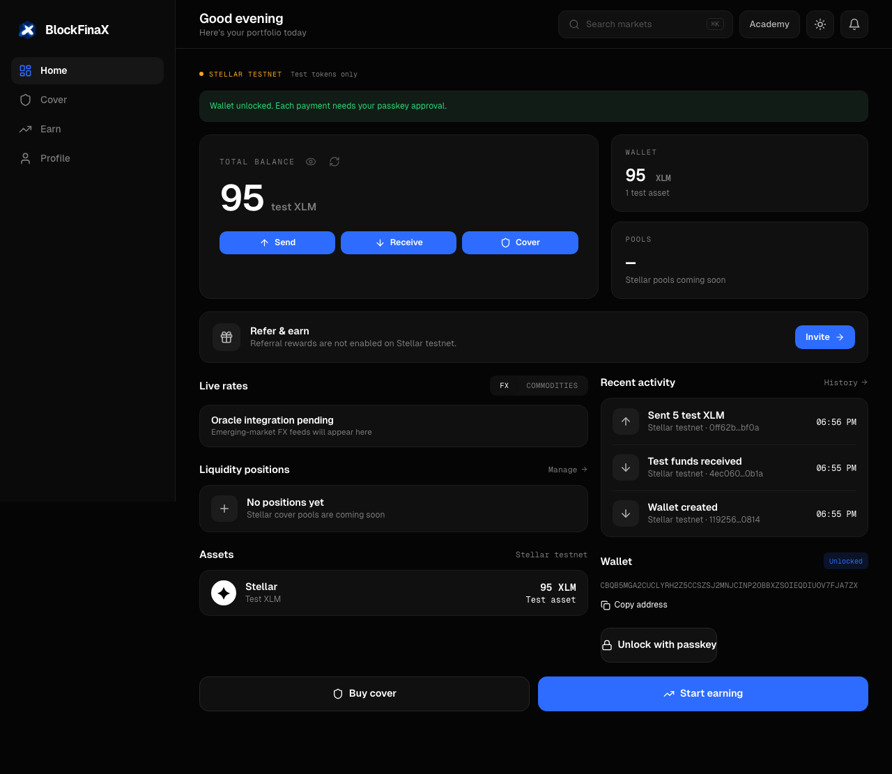

# BlockFinaX Stellar Wallet

> **This is the first standalone version of the wallet, published in October 2026 and no longer updated.** The current wallet runs inside the BlockFinaX app. Its code is in [`client/src/lib/wallets`](../client/src/lib/wallets) in the browser and [`server/wallet`](../server/wallet) on the server.

This folder stays as a small, self-contained example of the design: users sign in with an email code or Google, create a passkey, and use that passkey to authorize payments from a Soroban smart account. BlockFinaX runs the identity service, account registry and fee sponsor. The device holds the user's signing key. The smart account comes from Stellar's open-source Passkey Kit, pinned to a specific testnet WASM hash.



## Run locally

Use Node **22.18 or newer**.

```sh
npm ci
npm run setup:testnet
npm run dev
```

Open **http://localhost:5173**. Click **Sign in**, then enter an email address. A six-digit code is delivered through Resend. Enter the code, create a passkey, and open **Receive** and click **Receive test funds**. To test payments, create another wallet in a second browser profile and send to its `C…` address. A funded Stellar `G…` account also works as a recipient.

The setup script generates a fee-payer key, funds it through Friendbot and writes an ignored `.env` with restrictive file permissions. It never prints the secret. All activity uses Stellar **testnet**; the server fixes the network passphrase to testnet.

## Implemented

- Email verification codes: HMAC storage, five-minute expiry, single use, five attempts and a 60-second resend cooldown.
- Google OAuth authorization-code sign-in: expiring, single-use state validation and verified ID token/email, with clear cancellation and retry messages. Configure credentials before enabling it.
- HttpOnly session cookies, same-origin API checks and request limits.
- Server-verified P-256 passkey registration with required user verification.
- Smart-account deployment with the user's passkey as its persistent signer.
- Passkey unlock and on-chain signer/WASM checks before connecting.
- Live test XLM and Circle testnet USDC balances, passkey-approved transfers and confirmed transaction history. The app faucet funds XLM only; it does not mint or distribute USDC.
- A self-hosted transaction sponsor. It accepts only the signed user's wallet transferring the approved test XLM contract, with a 1,000-token payment limit, a 10 test XLM payment sponsorship cap, and a separate 30 test XLM wallet-deployment cap. Stellar verifies the contract authorization.
- SQLite storage and serialized fee-account submission to avoid sequence collisions in this single-process service.
- The current BlockFinaX app interface: original signed-in styles, Geist fonts, logo, Home/Cover/Earn/Profile navigation, dark/light theme, balance cards and responsive payment sheets. Cover, Earn and oracle feeds show their pending Stellar state.

Email or Google sign-in does not authorize payments or recover a lost passkey. Passkeys may sync through the user's device provider; that is not a BlockFinaX recovery service. Circle testnet USDC is not real value; the Base hedge contracts and oracle behavior have not been ported to Stellar.

## Configuration

See [.env.example](.env.example). Never put a secret in a `VITE_` variable.

For Google, add a Web Application OAuth client with redirect URI `http://localhost:5173/api/auth/google/callback` locally, or the exact HTTPS production origin plus that path. Set `GOOGLE_CLIENT_ID` and `GOOGLE_CLIENT_SECRET` on the server. Set `RESEND_API_KEY` and a verified `EMAIL_FROM` for email delivery.

For hosted use, build with `npm run build`, set `APP_ORIGIN` to the public HTTPS origin, `RP_ID` to its hostname, `NODE_ENV=production`, Resend and server secrets, then run `npm start`. Set `HOST=0.0.0.0` behind your hosting proxy. Preserve the SQLite database on a persistent volume. Passkeys created on localhost belong to localhost and will not work on another domain.

This version runs on Stellar testnet only and is not meant for real funds.

## Verify

```sh
npm test
npm run build
npx playwright install chromium
npm run test:e2e
```

The browser integration test uses a Chromium virtual authenticator and submits real Stellar testnet transactions. It requires a configured, funded fee payer and internet access. It checks deployment, funding, wallet-to-wallet payment, signing back in to the same wallet, rejection when the passkey is absent, reconnect after restoring the original virtual credential, and faucet limits. Restoring a test credential does not test a provider’s passkey sync or recovery with a new signing key. The browser test uses explicit local console code delivery. Resend delivery was separately verified against its automated test address. Google OAuth route tests use a simulated token exchange; a real Google account must still complete the hosted login to verify the provider exchange end to end.

## Architecture and API

Read [architecture](docs/architecture.md), [API](docs/api.md), and [threat model](docs/threat-model.md).

Upstream references: [Stellar smart wallets](https://developers.stellar.org/docs/build/guides/contract-accounts/smart-wallets), [Passkey Kit](https://github.com/stellar/passkey-kit), [Stellar JS SDK](https://github.com/stellar/js-stellar-sdk).

For offline development without Resend, set `EMAIL_DELIVERY=console`. Codes appear only in the server terminal. Production does not permit console delivery.
