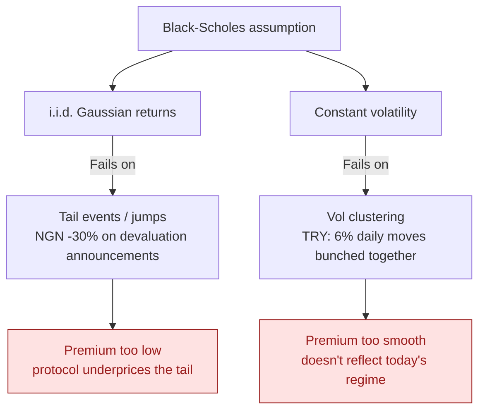
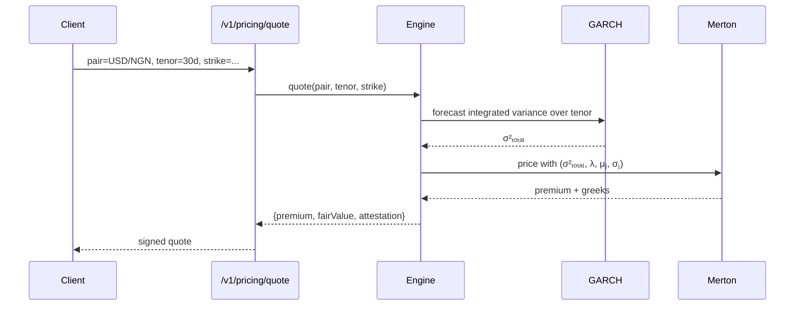

When we first stood up the protocol, premiums were quoted from a vanilla Black-Scholes model with a 30-day rolling vol. It was easy to ship and easy to reason about. It was also wrong, in two specific and very expensive ways for the pairs we care about.

This post is about what those failures looked like in practice, why they happen, and the v2 engine we replaced them with.

## Where Black-Scholes leaks

Black-Scholes assumes log-returns are i.i.d. Gaussian with constant volatility. Both halves of that assumption fail loudly on emerging-market FX:



Two concrete examples from our backtest:

- **NGN devaluation, June 2023.** The Central Bank of Nigeria unified rates overnight. NGN/USD moved ~30% in a single session. A model with normally distributed returns assigns roughly zero probability to a 30σ move; in reality, EM FX has a fat right tail and we got one. A premium priced off lognormal vol would have lost the LPs roughly an order of magnitude more than they collected.
- **TRY cluster, 2021 Q4.** Turkish lira had a stretch of 4–6% daily moves bunched into a two-week window. A 30-day rolling vol *averages over* that cluster — so on the day the cluster started, the model was still quoting yesterday's calm-regime premium. By the time the rolling window caught up, the move was already in.

The fix isn't tweaking parameters. It's modeling the two failure modes directly: jumps for the tail, and conditional vol for the clustering.

## What v2 actually does

The engine combines two well-studied pieces:

1. **Merton jump-diffusion** for the tail. Returns are modeled as a Brownian-motion component *plus* a compound Poisson jump component. Each pair gets its own calibrated `(λ, μⱼ, σⱼ)` — jump intensity, mean jump size, jump volatility — fit on its 22 years of history.
2. **GARCH(1,1)** for the volatility regime. Today's variance is a function of yesterday's squared return and yesterday's variance, so vol responds to recent shocks instead of waiting for a rolling window to roll over. We integrate the variance forecast across the option's tenor to get the right total variance.

The pricing pipeline:



## Calibration — where the work actually is

Modeling is the easy part. The expensive, error-prone part is calibration.

For each of the 84 pairs we support, we run three jobs against 22 years of daily history:

- **`pricing:calibrate-jumps`** — separates the diffusion process from the jump process via a thresholded MLE. Anything > 3.5σ in a sliding window is flagged as a jump; the diffusion process is re-fit to the residuals.
- **`pricing:calibrate-garch`** — fits the `(ω, α, β)` parameters of the GARCH(1,1) recursion via quasi-MLE.
- **`pricing:backtest`** — replays the calibrated model on the last 10 years of out-of-sample data, scoring the implied premiums against the realized payouts. If the implied loss ratio is outside 0.85–1.15, the pair gets flagged for manual review instead of going live.

A snippet of what backtest output looks like for a single pair:

```json
{
  "pair": "USD/NGN",
  "tenor": "30d",
  "trials": 1843,
  "premiumsCollected": 412_900,
  "payoutsPaid": 398_220,
  "lossRatio": 0.964,
  "tailEvents": [
    {"date": "2023-06-14", "move": -0.298, "premium": 12_400, "payout": 250_000}
  ]
}
```

The 96.4% loss ratio on USD/NGN is the kind of number that tells us the model is actually working — it's collecting roughly what it pays out on average, with the tail event (the devaluation) priced into the premiums leading up to it instead of being a silent disaster for the LPs.

## Things we considered and rejected

A short tour of the alternatives, so the v2 choice is the boring one in context:

- **SABR / stochastic-vol models.** More expressive than GARCH, but the calibration is hard and the tenor structure we care about (3–90 days) doesn't benefit much over GARCH(1,1). We may revisit when we add longer-tenor products.
- **Black-76 with implied-vol surface.** This is what the bank desks use. It works because they have access to a live options-quote feed for every pair they trade. We don't have that feed for USD/NGN; nobody does. Calibrating to history is the only realistic option.
- **Pure neural network.** Tempting because the architecture is fashionable. Two reasons we didn't: regulatory clarity (we can write down what Merton + GARCH does and defend it to an auditor; we can't do that with a black-box net) and tail behavior (a model trained on 22 years of data has seen ~10 real devaluation-class jumps — not enough to learn the tail without a strong prior).

## What this means for an integrator

If you're calling [`POST /v1/pricing/quote`](https://api.blockfinax.com/v1/docs#tag/pricing) from your app, none of this matters to you directly — the premium that comes back is the right one. But two things are worth knowing:

- The premium can change quickly when the regime shifts. GARCH is doing its job. Cache quotes for seconds, not minutes.
- Each quote returns an `attestation` field signed by the engine's key. If you want to prove the premium you showed a user matches what they paid, store the attestation alongside the trade.

The repo has a [calibration backfill script](https://github.com/BlockFinaX-LTD/integrator-api) and the full math in the pricing-engine README. Both are open-source.
