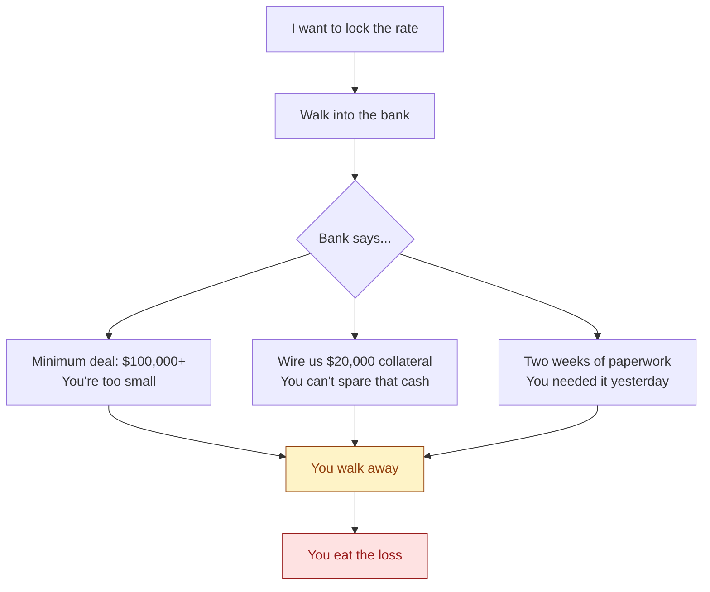
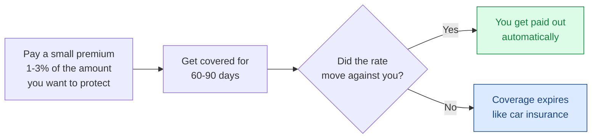

You sign a deal. Three months later, when it's time to pay, the currency has moved 10% against you. The deal you thought was profitable is now break-even. The deal you thought was tight is now a loss.

If you're running a business that buys, sells, or pays in a different currency than the one you bank in, this has happened to you. Probably more than once. This post is about how to stop it.

## A real example

Let's say you import goods from China. You agreed a price with your supplier:

- **Invoice:** $50,000 USD, due in 60 days
- **Today's rate:** 1 USD = 14.50 Ghana cedis (so the invoice costs you ₵725,000)
- **Your margin on the goods:** 18%

You close the deal in your books at ₵725,000. You expect to make 18%.

Two months later, when the invoice comes due, the cedi has moved to 15.80. Now the same $50,000 invoice costs you ₵790,000 — an extra ₵65,000 you weren't planning for.

Your 18% margin just dropped to 9%. Half your profit gone, on a deal you already won.

This isn't a hypothetical. It's a normal month in any emerging-market currency.

## Why most businesses don't fix this

There's a tool for this — it's been around for 50 years. It's called a **forward contract**. You walk into your bank and say: *"Lock the rate at 14.50 for me, even though I don't pay until 60 days from now."* Done. No surprise. No bleeding cash to the currency move.

So why doesn't every business do this? Three reasons:

**1. Minimum deal sizes.** Banks won't even talk to you unless you're hedging at least $100,000 at a time. If your invoice is $50,000, they say no.

**2. Collateral.** Even when they say yes, they want 30–50% of the deal in cash, sitting in an account, doing nothing, for the whole length of the hedge. On a $100,000 hedge, that's $30,000–$50,000 of your working capital frozen for three months. Most businesses need that cash for inventory, payroll, growth — not sitting in a bank account.

**3. Paperwork and time.** New banking relationship. Credit review. Legal docs. KYC. Two to six weeks before you can even place your first trade. If the currency just dropped 4% this morning, that ship has sailed.

The result: most businesses don't hedge. They just absorb the losses. Quietly. Month after month. Year after year.

## The simpler way

Think about how car insurance works:

- You pay a small fee (the premium) every year.
- If something bad happens, the insurance company pays you out.
- If nothing bad happens, you don't get the money back — and that's fine, because you didn't crash.
- You don't have to put down $20,000 in collateral. You don't fill out 40 pages of paperwork. You don't wait two weeks. You sign up and you're covered.

That's the model. Pay a small premium. If the currency moves against you past a certain line, you get paid out. Automatically.

## What this looks like in numbers

Back to the importer example:

- **You want to protect:** $50,000 over 60 days
- **You pay:** ~1.5% premium = $750
- **You don't put up any collateral.** All $50,000 of your working capital stays in your business.
- **If the cedi drops 5% or more against the dollar:** the contract pays you out the difference. You're covered.
- **If the cedi stays flat or strengthens:** the $750 is gone, like an insurance premium you didn't claim. Your deal goes through at the better rate and the premium was a small cost of doing business.

That's a small, known fee instead of an unknown, large loss. That's the trade.

## Who this is for

You should be looking at this if:

- You buy or sell in a currency that's not the one you bank in.
- Your deals are typically $1,000 to $500,000 — too small for traditional bank forwards to bother with.
- You can't (or don't want to) freeze a big chunk of working capital as collateral.
- You need protection *now*, not after two weeks of paperwork.
- You've watched the currency move 10–30% in a year and quietly absorbed the hit.

If any of that sounds like you, [start here](/hedge). It takes minutes, not weeks. There's no minimum. There's no collateral. You pay a small premium, you get covered.

You don't have to keep eating these losses.
