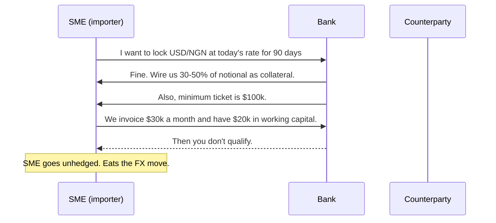
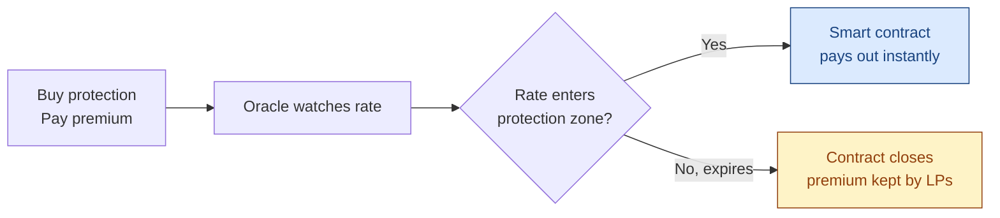

If you run a business that touches more than one currency — an importer paying suppliers in USD, an exporter invoicing in EUR, a payroll provider funding contractors in NGN — you have an FX problem. You may not call it that. You may call it *"margin compression"* or *"that month where we lost a chunk on the dollar"*. It's the same thing.

This post is about why the tools banks sell to solve this problem don't work for most SMEs, and what parametric protection does differently.

## The traditional gate

A traditional FX hedge — a forward, an option, a swap — works like this:

Two things are killing this for SMEs:

1. **Collateral lockup.** A 90-day forward on $100k of exposure might require $30k–$50k of cash sitting in a margin account, earning nothing, for three months. Most SMEs don't have that cash to spare — it *is* their working capital.
2. **Minimums.** Banks aren't set up to underwrite small tickets. The credit work to onboard a $30k forward costs the bank more than the spread they'll make on it, so they just refuse.

The result is the most boring possible outcome: SMEs *don't hedge*, and they absorb the volatility on their P&L. In emerging markets where the local currency can move 10–30% in weeks, that's not a small leak — that's the business.

## What parametric does differently

A parametric hedge is an insurance contract, not a derivative.

> You don't take a position. You pay a premium. If the rate moves into a pre-defined zone, the contract pays out. If it doesn't, the contract expires worthless — same as your car insurance.

There's no collateral lockup because there's no position to mark-to-market. The premium is the entire cost. Concretely, on BlockFinaX:

| | Traditional forward | BlockFinaX parametric |
|---|---|---|
| Upfront cost | 30–50% of notional | 0.5–3% of notional (premium only) |
| Minimum ticket | $100k+ | $1,000 |
| Settlement | Manual, T+2, bank-to-bank | On-chain, automatic, seconds |
| Counterparty | Bank credit risk | Smart-contract escrow |
| Customization | Bespoke, broker-mediated | Self-serve, any pair we have an oracle for |

## How a payout works

The protocol watches a price oracle for the pair you protected. If that oracle prints a rate inside your protection zone before expiry, the smart contract releases your payout automatically:

No claim forms. No phone calls to a broker. No reconciliation. If the price moved into the zone, the contract paid. If it didn't, it didn't.

## The honest tradeoffs

Parametric is not a strict upgrade over forwards in every dimension — it's a different shape. Two things to be honest about:

- **Basis risk.** A traditional forward locks the *exact* rate you'll transact at. Parametric pays a fixed payout if the index rate breaches the zone, which may differ slightly from the rate you actually get in your bank. For most SME use cases (covering losses on a known invoice), the basis is small and worth the trade for the lower upfront cost. For treasury operations measured in basis points, it's a real consideration.
- **Premiums aren't free.** A 1–3% premium isn't nothing, and if the rate never moves into the zone, you're out that premium. Same as paying car insurance and not crashing — you don't get the money back. The tradeoff is: you pay a small known cost to remove a large unknown loss.

## Who this is for

Parametric works best when:

- Your notional is too small for banks to take you seriously (< $100k tickets).
- Your working capital is too tight to lock up 30–50% in margin.
- You need protection on emerging-market pairs that banks either don't offer or quote at punitive spreads.
- You're fine with a small basis between the index rate and your actual transaction rate, in exchange for not having to underwrite a credit relationship with a bank.

If that's you, [start here](/hedge).
